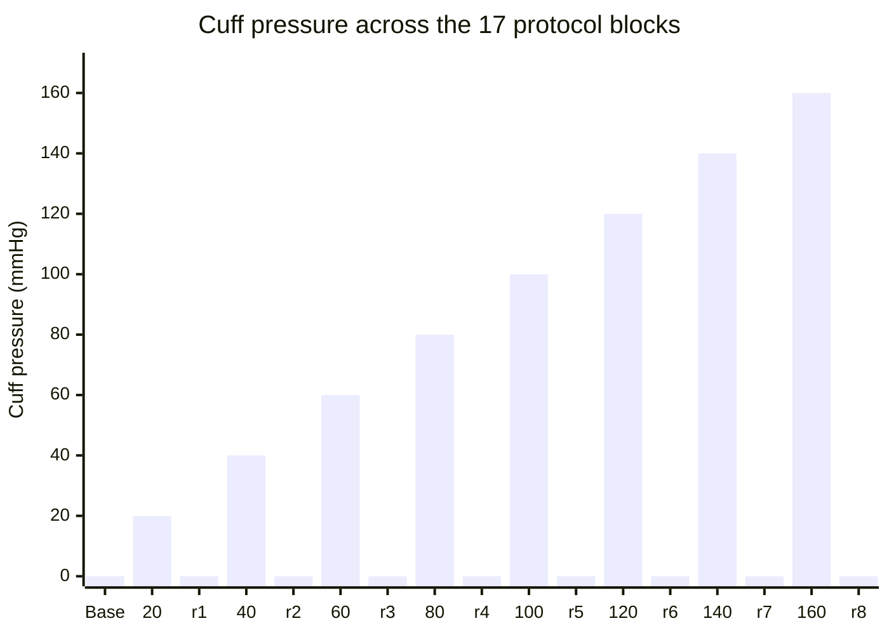
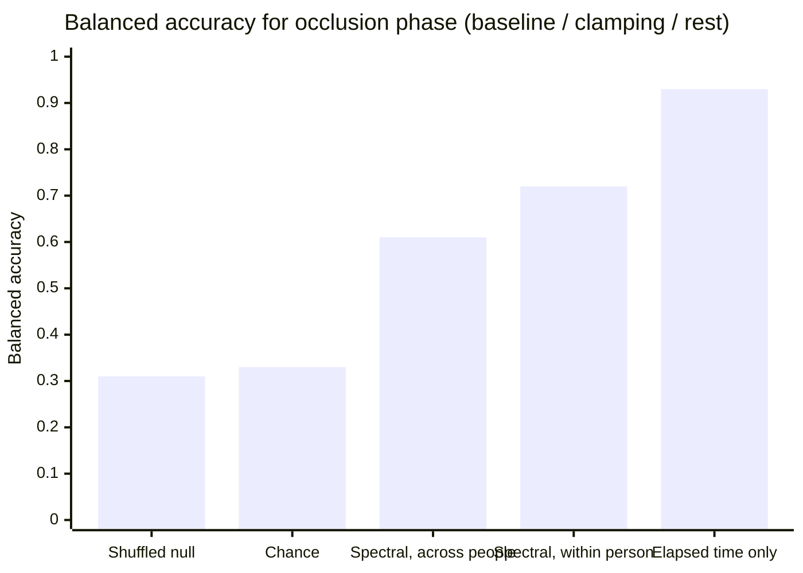

<div align="center">


<p>


</p>
<p>


</p>

**Sixteen colours of light, one palm, eight cuff pressures.**
<br/>
What can a visible-range snapshot camera tell us about blood in the skin, and what can't it?

</div>

---

## The 16 camera bands

The camera is a snapshot mosaic sensor. Each frame carries 16 narrow bands between 465 and 641 nm, which is where oxy- and deoxyhaemoglobin absorb most strongly in the visible range. Each badge below is shown in the approximate colour of its wavelength.

<div align="center">


<br/>


<sub>Filter FWHM 6–21 nm. Some filters leak: the secondary lobe reaches 0.81 of the peak at 598 nm, which matters later.</sub>

</div>

## What this project is

Peripheral arterial disease is usually assessed with contact measurements such as the ankle–brachial index, which describe the large arteries or a single patch of skin. Hyperspectral imaging promises something different: a contact-free picture of how much haemoglobin is in the tissue and how oxygenated it is. The published clinical results are mixed, though, and most pipelines are closed.

PMHM (Peripheral Microvascular Health Monitoring) is my attempt to do the groundwork properly on open data. It has two parts:

1. **A dataset.** I converted the open [SPECTRALPACA](https://doi.org/10.1038/s41597-024-03307-y) recordings (about 250 GB of blosc2 cubes, CSVs and calibration files) into one validated 59 MB Parquet file that any Parquet reader can open without the original download or any custom code.
2. **An analysis.** A two-cell notebook runs a pre-registered analysis plan (steps S0 to S14) on that file, end to end, on free Colab or Kaggle hardware.

The headline is a negative one, and I think it is the most useful part. Neither of the two pre-specified hypotheses held up, and a model that only knew the elapsed time beat every spectral model at predicting the protocol phase. Details are below.

> [!IMPORTANT]
> These are 10 healthy volunteers under a controlled cuff-occlusion protocol, and only 2 of them have camera data in the file. Nothing here measures StO₂ or perfusion directly, and nothing here supports a diagnostic claim for PAD.

## How the pieces fit

```mermaid
flowchart LR
    subgraph SRC["Open source data"]
        A["SPECTRALPACA<br/>~250 GB<br/>video cubes, ROI tracks,<br/>spectrometer, optics"]
    end

    subgraph BUILD["Dataset build (src/pmhm)"]
        B["inventory<br/>SHA-256 of every raw file"]
        C["convert<br/>10 typed Parquet tables"]
        D["validate<br/>131 checks vs raw CSV"]
        E["standalone<br/>ROI spectra pulled<br/>from the cubes"]
    end

    F[("spectralpaca_pmhm_dataset.parquet<br/>59 MB · 4.59 M rows · 81 cols")]

    subgraph NB["Notebook pmhm_phase_a_e.ipynb"]
        G["A · Foundation<br/>S0–S2"]
        H["B · Signal conditioning<br/>S3–S7"]
        I["C · Features<br/>S8–S9"]
        J["D · Physiology<br/>S10–S12"]
        K["E · Agreement & models<br/>S13–S14"]
    end

    L["tables · figures ·<br/>models · reports"]
    M["F · Consolidation<br/>S17–S18 (planned)"]

    A --> B --> C --> D --> E --> F
    F --> G --> H --> I --> J --> K --> L --> M

    classDef src fill:#0092FF,stroke:#005BB5,color:#fff
    classDef build fill:#08C46A,stroke:#067A43,color:#fff
    classDef file fill:#8A2BE2,stroke:#5B1A99,color:#fff
    classDef nb fill:#FF9E00,stroke:#B86F00,color:#1a1a1a
    classDef out fill:#FF1B00,stroke:#A81200,color:#fff
    classDef todo fill:#6E7781,stroke:#424A53,color:#fff,stroke-dasharray: 5 5
    class A src
    class B,C,D,E build
    class F file
    class G,H,I,J,K nb
    class L out
    class M todo
```



## Roadmap by phase

The repository follows the phases of the [implementation plan](docs/PMHM_Implementation_Plan.pdf). Each folder has its own README with the steps, where they sit in the notebook, and what the first run found.

| Phase | Steps | Folder | Status |
|:--|:--|:--|:--|
| **0** Data engineering | inventory → convert → validate → standalone | [`phase_0_data_engineering/`](phase_0_data_engineering/) |  |
| **A** Foundation | S0–S2 | [`phase_A-E_analysis/A_foundation/`](phase_A-E_analysis/A_foundation/) |  |
| **B** Signal conditioning | S3–S7 | [`phase_A-E_analysis/B_signal_conditioning/`](phase_A-E_analysis/B_signal_conditioning/) |  |
| **C** Features | S8–S9 | [`phase_A-E_analysis/C_features/`](phase_A-E_analysis/C_features/) |  |
| **D** Physiological response | S10–S12 | [`phase_A-E_analysis/D_physiological_response/`](phase_A-E_analysis/D_physiological_response/) |  |
| **E** Agreement and models | S13–S16 | [`phase_A-E_analysis/E_agreement_and_models/`](phase_A-E_analysis/E_agreement_and_models/) |  |
| **F** Consolidation | S17–S18 | [`phase_F_consolidation/`](phase_F_consolidation/) |  |

Phases A–E all run from the one notebook, [`phase_A-E_analysis/pmhm_phase_a_e.ipynb`](phase_A-E_analysis/pmhm_phase_a_e.ipynb).

## The protocol

Each volunteer sat with the right palm under the camera for about 18 minutes. After a two-minute baseline, a cuff on the upper arm was inflated in 20 mmHg steps up to 160 mmHg. Each step lasted about a minute and was followed by a minute at zero pressure. That gives 17 blocks per session (r1–r8 below are the rest periods).



One design flaw is visible straight away. The pressure always rises in the same order, so pressure and time are perfectly confounded. A lot of the analysis is about not being fooled by that.

## Results from the first full run

All numbers come from one complete run of the notebook (S0 to S14). They are provisional until the frozen analysis plan is signed off.

| Question | What I expected | What happened | Verdict |
|:--|:--|:--|:--:|
| **H1.** Does the 550/609 nm haemoglobin ratio fall steadily as cuff pressure rises? | A monotone fall, detectable from 60 mmHg | The ratio dipped most at 100–120 mmHg (−0.022 and −0.032) and came back to about zero at 140–160 mmHg. Trend p = 0.87 and 0.67. Spectrometer arm (n = 10): 4 rose, 6 fell, p = 0.25 |  |
| **H2.** Do ratio features generalise across people better than raw counts? | Lower error for ratios in every cross-participant test | Better on the camera (0.58 / 0.50 vs 0.41 / 0.40 balanced accuracy), no advantage on the 10-person spectrometer task (0.56 vs 0.59, p = 0.72) |  |
| **RQ2.** How does the skin recover after each release? | Exponential recovery | Only 43% of exponential fits passed, so model-free measures were used. Recovery was still incomplete at 20 s in 10 of 11 blocks |  |
| **RQ3.** Which feature family is robust? | Normalised features beat raw counts | L1-normalised spectra, band ratios and Beer–Lambert indices met the robustness rule |  |

The non-monotone shape is interesting. One reading is that absorption peaks when the cuff sits between venous and arterial pressure (blood flows in but can't drain out), then shrinks once arterial inflow stops too. I can't confirm that from two people who were also used to spot it, so it stays an exploratory observation for independent data.

### Phase classification: the time-only trap



The best spectral model across participants reached 0.61 (Beer–Lambert indices, logistic regression). That is clearly above chance. But a model given nothing except the timestamp got 0.93, because it simply learns the schedule. Any study with a fixed pressure order needs this control, and I'd be suspicious of results reported without it.

Other model results:

- Pressure regression across participants: RMSE 35.6 mmHg against 45.9 mmHg for always predicting the mean.
- Spectrometer task (10 people, leave-one-participant-out): SVM reached 0.70 with L1-normalised or ratio features and 0.59 with raw values.
- The temporal networks (TCN and GRU, each under 100k parameters) did worse than the best classical model in every comparison, by 0.14–0.19 for phase classification.

### Feature robustness

| Feature family | Between-person CV | Baseline drift | Effect / noise at 160 mmHg | Dark sensitivity | Robust |
|:--|:-:|:-:|:-:|:-:|:-:|
| Raw counts | 0.236 | 1.90 | 2.79 | n/a | reference |
| Relative reflectance | n/a | 1.90 | 2.76 | 0.09 | ❌ |
| L1-normalised | **0.028** | **0.77** | 3.40 | 0.17 | ✅ |
| Band ratios | 0.040 | **0.77** | 3.14 | 0.16 | ✅ |
| Beer–Lambert indices | n/a | 0.94 | **4.99** | 0.11 | ✅ |

<sub>Family medians. Drift is the absolute baseline slope per 100 s relative to baseline SD.</sub>

### Camera vs spectrometer

They agree poorly. At 160 mmHg the camera change sat on average 29.2 percentage points below the spectrometer change (limits of agreement −46.8 to −11.6, ICC 0.21). The spectrometer isn't a clean reference either: replicate spectra at a single site vary by a median 16%, and by 27% across sites. So neither instrument should be treated as ground truth for the other.

<details>
<summary><b>Calibration notes</b> (no white reference, leaky filters)</summary>
<br/>

The source download has no white reference, and the dark frame has no recorded exposure. The notebook works around this instead of pretending it isn't there:

- **Dark offset.** Three dark-offset scenarios are run. No clamp-stage change of the primary ratio changed sign across them.
- **Forward model.** Spectrometer spectra are projected through the 16 measured filter curves and the xenon source spectrum. At most 0.29% of any band's response falls outside the spectrometer's range.
- **Effective gain.** A gain fitted on one participant predicted the other's baseline counts within 15% in all 16 bands, in both directions.
- **Cross-talk correction (rejected).** A leave-one-participant-out unmixing cut the held-out spectral angle on skin from 8.8° to 0.03°. It also roughly doubled the non-flatness of every neutral colour-checker patch. It had learned the narrow range of skin spectra and didn't transfer, so I didn't adopt it.

</details>

<details>
<summary><b>Leakage controls</b></summary>
<br/>

With 25 Hz video, it's easy to leak information between neighbouring frames and report numbers that look great. The validation rules:

- Within-participant splits use thirds of each block with a 5 s purge gap.
- Cross-participant models train on one person and test on the other.
- The spectrometer task uses leave-one-participant-out.
- Hyper-parameters are tuned only inside training folds.
- Every model is compared against a shuffled-label null, a time-only model and a drift check.
- Uncertainty comes from moving-block or participant-level bootstraps (2,000 resamples).

</details>

## The dataset file

[`data/spectralpaca_pmhm_dataset.parquet`](data/) holds everything in one table. Each row has a `record_type`; filter on it first.

| `record_type` | Rows | One row is |
|:--|--:|:--|
| `roi_frame` | 125,323 | One tracked 20×20 px palm ROI in one video frame, with mean and SD of all 16 channels |
| `frame` | 48,157 | One video frame: stage, time, exposure (no pixels) |
| `spectrometer` | 4,397,250 | One wavelength sample of one HR2000+ reflectance spectrum (550 wavelengths, 425–675 nm) |
| `camera_filter` | 9,616 | One sample of a camera filter response curve |
| `light_source` | 2,033 | One sample of the xenon source spectrum |
| `color_checker` | 3,840 | One colour-checker patch reference for one camera band |
| `channel` | 16 | One camera channel: wavelength, FWHM, cross-talk, dark statistics |
| `stage` | 10 | One protocol stage |
| `subject` | 10 | One participant and what data exist for them |

```python
import pandas as pd

f = "data/spectralpaca_pmhm_dataset.parquet"

# Camera ROI time series, empty columns dropped
roi = pd.read_parquet(f, filters=[("record_type", "==", "roi_frame")]).dropna(axis=1, how="all")

# One participant's spectrometer data, pivoted to one spectrum per row
spec = pd.read_parquet(f, filters=[("record_type", "==", "spectrometer"), ("subject_id", "==", "subject_03")])
wide = spec.pivot_table(index=["stage", "roi_id", "spectrum_index"], columns="wavelength_nm", values="value")
```

It works the same way in polars, DuckDB or R's `arrow`. Every column is documented in [`STANDALONE_DATASET.md`](phase_0_data_engineering/pmhm_project_backup/docs/STANDALONE_DATASET.md).

| Coverage | Camera ROI spectra | Spectrometer |
|:--|:-:|:-:|
| Participants | 2 of 10 (subjects 01, 02) | **10 of 10** |
| Stages | all 17 blocks, 25 Hz | baseline and 160 mmHg |
| Per unit | 7 tracked ROIs | ~100 replicate spectra per subject × ROI × stage |

> [!NOTE]
> ROI values are raw camera counts with no dark or white correction. Full video frames are not included (they would be about 214 GB); only the tracked ROI statistics are.

**File integrity.** SHA-256 `eb77b66a76f27eab5a053fe564954d9fe4ef584423f1053cb46542ac38961226`. The notebook checks this before it runs. For the standalone file, 22 of 23 checks passed and none failed; 400 random ROI rows were re-extracted from the original cubes and matched.

## Running it

**Locally**

```bash
git clone https://github.com/corbinalif/VASCAN.git
cd VASCAN
pip install -r phase_0_data_engineering/pmhm_project_backup/requirements-pmhm.txt
cd phase_A-E_analysis
jupyter lab pmhm_phase_a_e.ipynb
```

Run locally, the notebook reads `../data/spectralpaca_pmhm_dataset.parquet`, and searches the repository if the file isn't there.

**On Colab or Kaggle,** put the Parquet file at `MyDrive/PMHM/` (Colab) or attach it as a Kaggle dataset. The notebook detects where it is running.

All settings live in the first block of cell 2. The ones you'll likely touch:

```python
QUICK_TEST = True        # smoke test: small bootstraps, short training
EXPERIMENTS = "all"      # or e.g. ["S10", "S14"]; dependencies run automatically
RESUME = True            # reuse cached steps when the configuration hash matches
DEVICE = "auto"          # "cpu" | "cuda"
```

A full run took about 13 minutes on a CPU. Results go to `phase_A-E_analysis/pmhm_outputs/`: `tables/`, `figures/`, `models/`, `predictions/`, a frozen `analysis_plan/`, and a Markdown report with a machine-readable JSON summary.

<details>
<summary><b>Rebuilding the Parquet file from the raw data</b></summary>
<br/>

You only need this if you want to reproduce the conversion. It needs the full SPECTRALPACA download from Synapse (`syn51625685`), which is about 250 GB.

```bash
cd phase_0_data_engineering/pmhm_project_backup
python scripts/pmhm_build_dataset.py all   # inventory → convert → validate → standalone → card
pytest tests/
```

Each stage can also be run on its own: `inventory`, `convert`, `validate`, `standalone`, `card`.

</details>

## What's in this repository

```
VASCAN/
├── README.md
├── docs/                                   proposal and plan
│   ├── PMHM_Research_Proposal.pdf            v1.0
│   ├── PMHM_Research_Proposal_v2.pdf         v2.0, with first-run results
│   └── PMHM_Implementation_Plan.pdf          steps S0–S18, phases A–F
├── data/
│   └── spectralpaca_pmhm_dataset.parquet   the whole dataset, one file (59 MB)
├── phase_0_data_engineering/               raw release → validated Parquet
│   ├── pmhm_project_backup/                  pipeline code, docs, validation reports, logs
│   │   ├── src/pmhm/                           inventory, convert, validate, standalone, card
│   │   ├── scripts/pmhm_build_dataset.py       command-line entry point
│   │   ├── tests/  configs/  docs/  reports/
│   └── pmhm_project_backup.zip               archived copy of the folder above
├── phase_A-E_analysis/
│   ├── pmhm_phase_a_e.ipynb                  one notebook for S0–S14 (+ gated S15)
│   ├── A_foundation/                         S0–S2
│   ├── B_signal_conditioning/                S3–S7
│   ├── C_features/                           S8–S9
│   ├── D_physiological_response/             S10–S12
│   └── E_agreement_and_models/               S13–S16
└── phase_F_consolidation/                  S17–S18, not started
```

## Limits worth knowing

- **Two camera participants.** Camera results are within-person findings. Population-level claims rest only on the 10-person spectrometer arm.
- **Visible range only.** 465–641 nm. There's no near-infrared, so deeper tissue and the usual NIR oxygenation bands are out of reach.
- **No reflectance calibration.** No white reference exists in the source data, so absolute reflectance from the camera is an estimate.
- **Pressure order is fixed.** Placebo and drift checks address the time confound but can't remove it.
- **Healthy volunteers.** Cuff occlusion is a physiological perturbation model, not a patient cohort.

## Credit and licence

The source data is **SPECTRALPACA**: Ayala *et al.*, "SPECTRAL Perfusion Arm Clamping dAtaset", *Scientific Data* (2024), [doi:10.1038/s41597-024-03307-y](https://doi.org/10.1038/s41597-024-03307-y), released under [CC BY 4.0](https://creativecommons.org/licenses/by/4.0/). The derived Parquet file carries the same licence. If you use it, please cite the original paper.

<div align="center">


</div>
