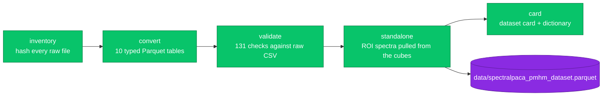

# Phase 0 · Data engineering


This is the work that came before the implementation plan's Phase A. It matches the scope of proposal v1.0: turn the raw SPECTRALPACA release into a validated, analysis-ready dataset. Its output is the single file in [`../data/`](../data/) that every later phase reads.

## What's here

| Path | What it is |
|:--|:--|
| [`pmhm_project_backup/`](pmhm_project_backup/) | The pipeline that built the dataset: `src/pmhm/`, `scripts/`, `tests/`, `configs/`, plus its docs, validation reports and run logs |
| [`pmhm_project_backup.zip`](pmhm_project_backup.zip) | Archived copy of the same folder. The plan's optional step SX refers to it by this name |

The folder keeps its original internal layout, because the code resolves paths relative to it.

## Pipeline stages



```bash
cd phase_0_data_engineering/pmhm_project_backup
python scripts/pmhm_build_dataset.py all      # or: inventory | convert | validate | standalone | card
pytest tests/
```

Rebuilding needs the raw release from Synapse (`syn51625685`, about 250 GB), which is not in this repository. Set `dataset_root` in `configs/pmhm.yaml` to wherever you downloaded it.

## Key documents

- [Dataset card](pmhm_project_backup/docs/DATASET_CARD.md): every parameter, computed from the data
- [Standalone file reference](pmhm_project_backup/docs/STANDALONE_DATASET.md): all 81 columns and how to read them
- [Data dictionary](pmhm_project_backup/docs/DATA_DICTIONARY.md)
- [Technical decisions](pmhm_project_backup/docs/TECHNICAL_DECISIONS.md)
- [Validation report](pmhm_project_backup/reports/validation_full.md) and [standalone validation](pmhm_project_backup/reports/validation_standalone.md)

## Findings that shaped the later phases

- Only 3 of the 10 participants had complete video cubes in the source download, and only 2 had ROI tracks. That limit runs through the whole analysis.
- There's no white reference, and the dark frame has no recorded exposure. Phase B exists largely because of this.
- 14,705 spectrometer values are negative. They were kept and flagged, not clipped.
- 1,796 ROI rows were tracked after the video ended. They're kept, with `has_image_frame = false`.
